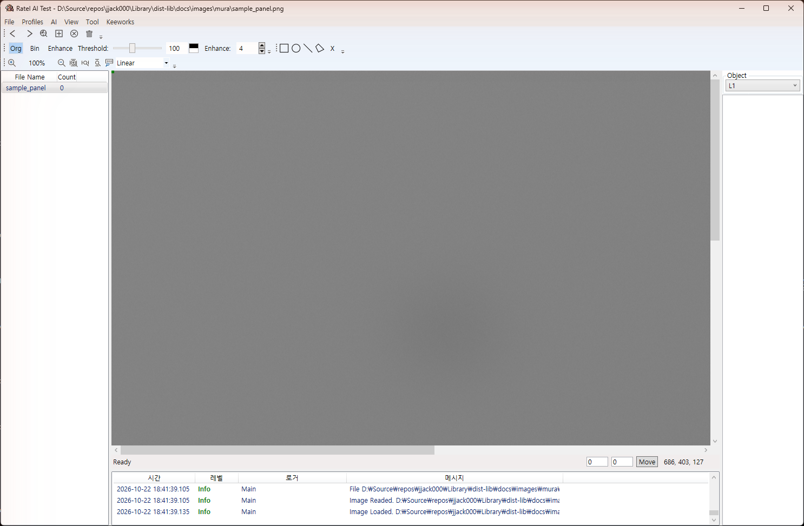
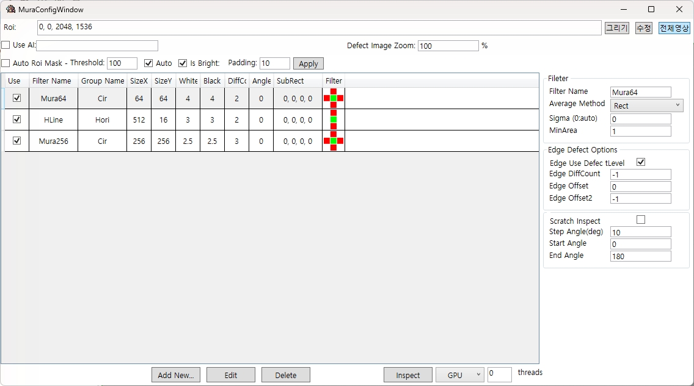
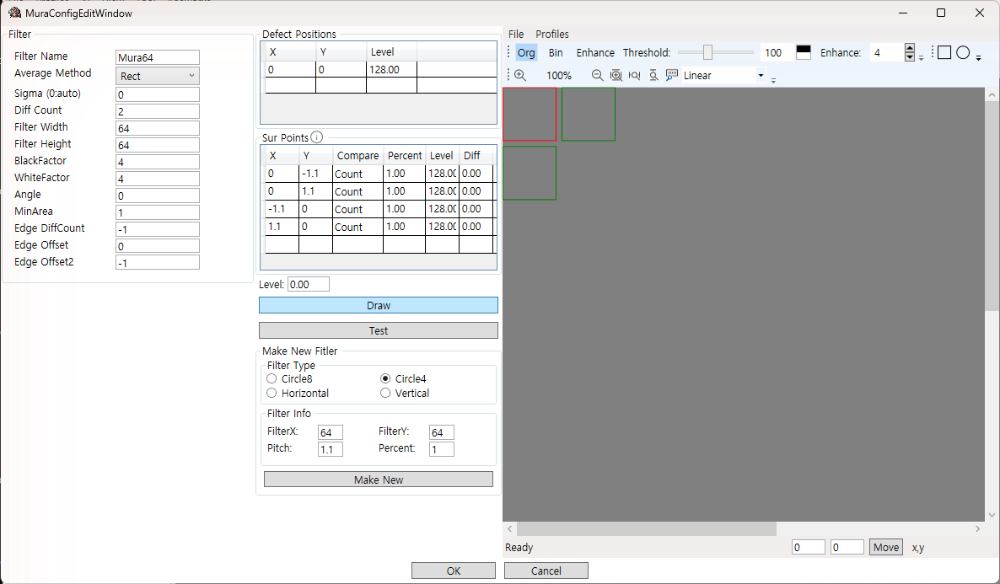
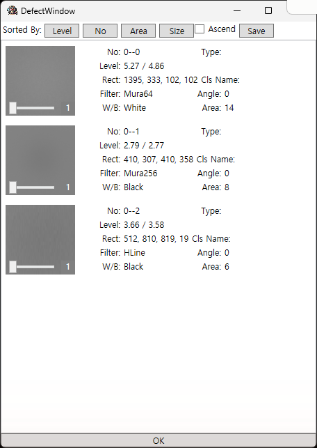
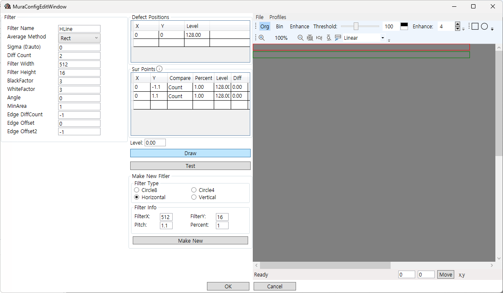
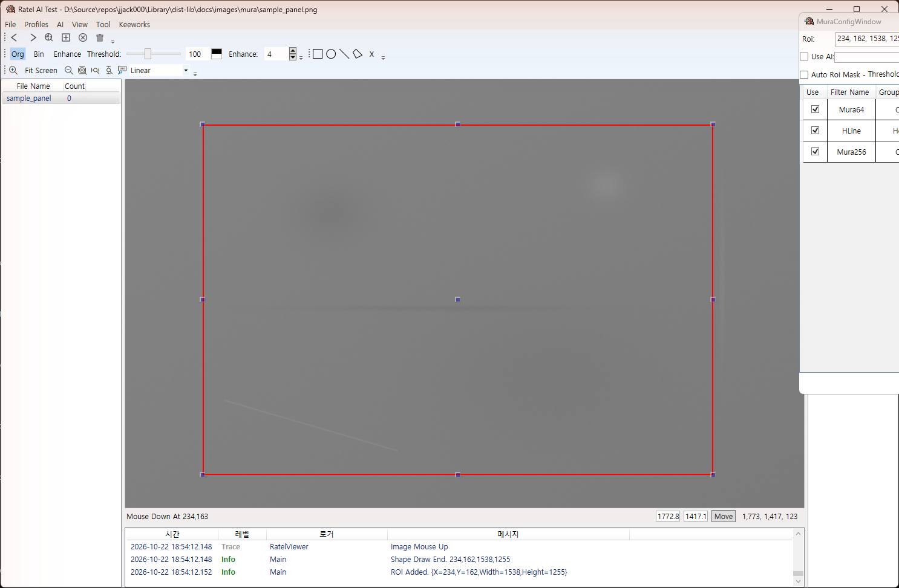
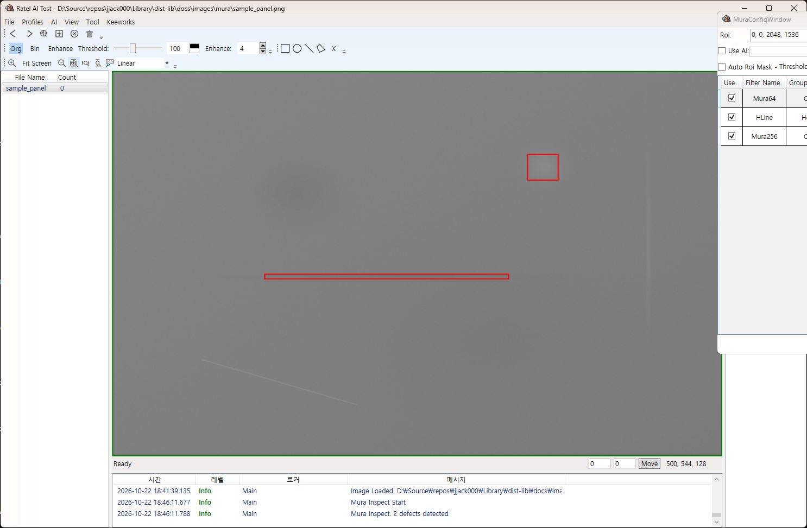
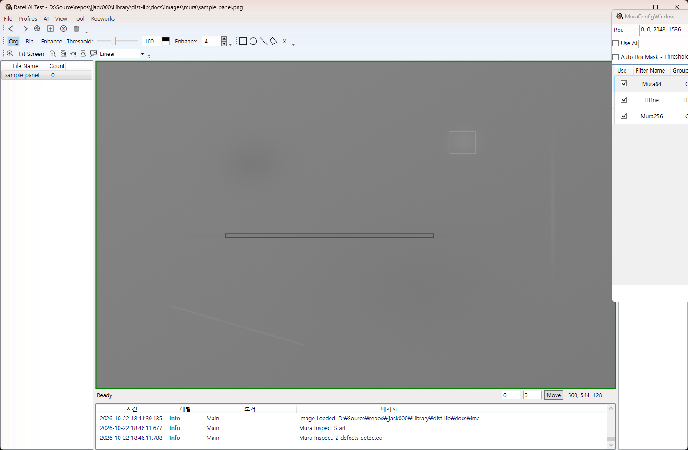
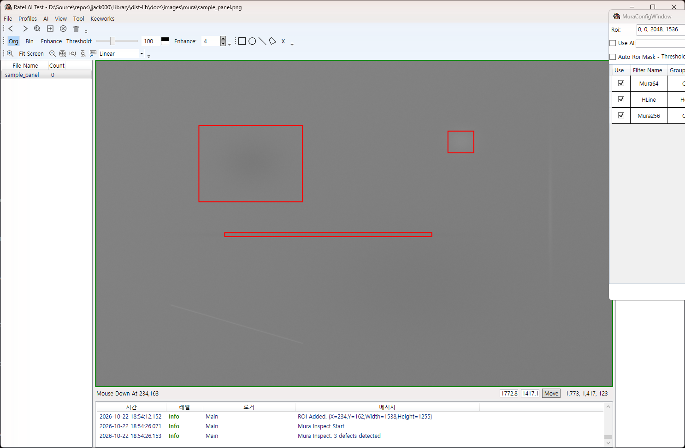
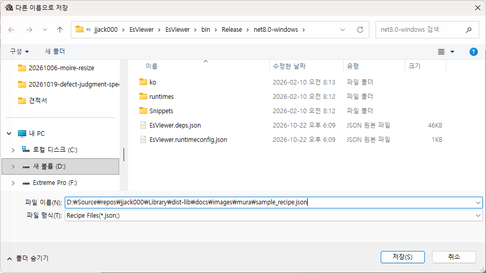

# Mura 검사 사용자 매뉴얼

얼룩(Mura) 검사 기능을 현장에서 설정하고 조정하는 분을 위한 문서다. 프로그래밍 지식 없이 읽을 수 있도록 검사 원리, 화면의 각 항목이 뜻하는 것, 설정값을 정하고 맞추는 방법을 설명한다. 화면 설명과 따라하기는 RatelSoft의 검사 도구 **EsViewer**를 기준으로 한다. 같은 검사 엔진을 쓰는 다른 장비 프로그램도 항목 이름과 의미는 같다.

개발자가 코드에서 검사 기능을 호출하는 방법은 `MURA_API_MANUAL.md`에 따로 있다.

연습용 파일이 함께 제공된다.

- `images/mura/sample_panel.png`: 여러 종류의 얼룩을 넣은 연습용 패널 영상
- `images/mura/sample_recipe.json`: 이 문서의 따라하기에서 만든 레시피

## 1. 얼룩 검사란

### 1-1. 얼룩

얼룩은 디스플레이 패널, 필름, 유리처럼 고르게 보여야 하는 면에서 주변보다 조금 밝거나 어두운 부분이 넓게 퍼져 있는 결함이다. 점 결함처럼 경계가 뚜렷하지 않고, 밝기 차이가 몇 단계에 불과한 경우가 많아 사람 눈으로도 멀리서 봐야 보인다.

연습용 영상에는 다음 얼룩이 들어 있다. 화면을 멀리서 보면 희미하게 보인다.



- 왼쪽 위: 둥근 어두운 얼룩
- 오른쪽 위: 작은 밝은 얼룩
- 가운데: 가로로 긴 어두운 띠
- 오른쪽: 세로로 긴 밝은 띠
- 왼쪽 아래: 비스듬한 가는 스크래치
- 오른쪽 아래: 넓고 아주 희미한 어두운 얼룩

### 1-2. 검사 원리

검사는 사람이 패널을 멀리서 보며 "저기가 주변보다 조금 어둡다"라고 판단하는 과정을 수치로 바꾼 것이다. 순서는 다음과 같다.

1. **창으로 뭉개서 본다.** 영상을 일정 크기의 창(필터)으로 평균한다. 창 크기가 64×64이면 64×64픽셀 안의 평균 밝기가 하나의 값이 된다. 이 과정에서 픽셀 노이즈와 작은 점은 사라지고 창 크기 정도의 밝기 변화만 남는다. 그래서 **창 크기는 찾고 싶은 얼룩의 크기**로 정한다.
2. **중심과 주변을 비교한다.** 창을 조금씩 옮겨 가며 중심 창의 밝기와 그 주변 창(위, 아래, 왼쪽, 오른쪽)의 밝기를 비교한다. 주변을 어디에 둘지는 필터 종류로 정한다.
3. **차이가 기준을 넘으면 얼룩 후보다.** 중심이 주변보다 `White Level` 이상 밝으면 밝은 얼룩(White), `Black Level` 이상 어두우면 어두운 얼룩(Black) 후보가 된다. 이때 몇 방향에서 차이가 나야 하는지가 `Diff Count`다.
4. **후보를 묶어 하나의 불량으로 만든다.** 후보는 창 단위로 생기므로 얼룩 하나에서 여러 개가 나온다. 서로 붙어 있는 후보를 하나로 묶고, 위치(사각형)와 밝기 차이(레벨)를 결과로 낸다.

```
필터 종류별 비교 위치 (C: 중심, S: 비교하는 주변, s: 평균에만 쓰는 주변)

   Circle4           Circle8          Horizontal        Vertical
      [S]           [s] [S] [s]           [S]
  [S] [C] [S]       [S] [C] [S]           [C]          [S] [C] [S]
      [S]           [s] [S] [s]           [S]
```

- Circle4: 상하좌우 네 방향과 비교한다. 둥근 얼룩에 쓰는 기본 필터다.
- Circle8: 네 방향으로 판정하고 대각선 네 곳은 평균에만 쓴다. 레벨 값이 더 안정적이다.
- Horizontal: 위아래만 비교한다. 가로로 긴 얼룩이나 띠를 찾는다. 창을 가로로 길게 만든다.
- Vertical: 좌우만 비교한다. 세로로 긴 얼룩용이다. 창을 세로로 길게 만든다.

밝기 단위는 0~255 단계다. `White Level`이 5이면 "주변보다 5단계 이상 밝아야 한다"는 뜻이다.

### 1-3. 결과에 나오는 값

| 항목 | 뜻 |
| --- | --- |
| Level (앞 숫자) | 중심과 주변 평균의 밝기 차이. 얼룩이 얼마나 뚜렷한지 |
| Level (뒤 숫자) | 조건을 만족한 방향 중 가장 작은 차이. 얼룩의 가장 약한 경계 |
| W/B | White(밝은 얼룩) 또는 Black(어두운 얼룩) |
| Rect | 위치와 크기. X, Y, 폭, 높이 |
| Area | 묶인 후보의 수. 얼룩의 면적에 해당 |
| Filter | 이 얼룩을 찾은 필터 이름 |

등급을 나눌 때는 보통 Level의 앞 숫자를 쓴다.

## 2. 화면 구성

### 2-1. 메인 화면

EsViewer를 실행하고 영상 파일이나 폴더를 창에 끌어다 놓으면 왼쪽 목록에 파일이 나타나고 가운데에 영상이 표시된다. `File > Load Image Folder`로 폴더를 열 수도 있다. 아래쪽에는 로그가 표시된다.

### 2-2. Mura Setup 창

`Tool > Mura Setup`을 누르면 검사 설정 창이 열린다. 이 창에서 필터를 추가하고 검사를 실행한다.



| 영역 | 설명 |
| --- | --- |
| Roi | 검사할 영역. `그리기`로 영상에 사각형을 그리고, `수정`으로 고치고, `전체영상`으로 전체를 검사 영역으로 되돌린다 |
| Use AI | 검출된 얼룩을 AI 모델로 다시 분류하는 옵션. 얼룩 검사 자체와는 무관하다 |
| Auto Roi Mask | 밝기 기준으로 제품 영역을 자동으로 찾아 그 밖을 검사에서 뺀다. 3-6절 |
| 필터 목록 | 검사에 쓰는 필터들. 한 행이 필터 하나다. `Use`를 끄면 그 필터는 검사하지 않는다 |
| 오른쪽 상세 | 목록에서 선택한 필터의 추가 항목(평균 방법, 가장자리 옵션, 스크래치 옵션) |
| Add New / Edit / Delete | 필터 추가, 편집, 삭제 |
| Inspect | 검사 실행. 오른쪽에서 실행 방식(Single, Multi, GPU)과 스레드 수를 고른다 |

### 2-3. 필터 편집 창

`Add New...` 또는 `Edit`를 누르면 필터 하나를 편집하는 창이 열린다.



| 영역 | 설명 |
| --- | --- |
| Filter (왼쪽) | 필터 이름, 창 크기, 밝기 기준 등 주요 설정 |
| Defect Positions | 중심 창의 위치. 보통 (0, 0) 하나 |
| Sur Points | 비교할 주변 창의 위치와 비교 방식 |
| Draw | 중심(빨간색)과 주변(초록색) 배치를 오른쪽에 그려 확인한다 |
| Test | 오른쪽에 연 영상에 이 필터 하나만 검사해 본다 |
| Make New Filter | 필터 종류와 크기를 고르고 `Make New`를 누르면 그에 맞는 Defect Positions와 Sur Points가 자동으로 채워진다 |
| OK / Cancel | 편집 내용을 반영하거나 취소한다 |

### 2-4. 결과 창 (DefectWindow)

검사가 끝나면 검출된 얼룩 목록이 결과 창에 나타나고, 메인 화면 영상에는 빨간 사각형이 그려진다.



- `Level`, `No`, `Area`, `Size` 버튼으로 정렬한다. `Ascend`를 켜면 오름차순이다.
- 항목을 누르면 메인 화면에서 그 얼룩이 초록색으로 강조되고 화면이 그 위치로 이동한다.
- `Save`로 결과를 파일로 저장한다.

## 3. 따라하기

연습용 영상 `sample_panel.png`로 처음부터 끝까지 한 번 해 본다.

### 3-1. 영상 열기

EsViewer를 실행하고 `sample_panel.png`를 창에 끌어다 놓는다. 왼쪽 목록에 파일이 나타나고 영상이 표시된다. 툴바의 `Fit Screen`을 누르면 전체가 보인다.

### 3-2. 첫 번째 필터 만들기

1. `Tool > Mura Setup`을 연다.
2. `Add New...`를 누른다.
3. Make New Filter에서 `Circle4`를 고르고 FilterX와 FilterY에 64, Pitch에 1을 넣은 뒤 `Make New`를 누른다. Sur Points에 네 방향이 채워진다.
4. 왼쪽에서 Filter Name을 `Mura64`, BlackFactor와 WhiteFactor를 4로 바꾼다.
5. `Draw`를 누르면 오른쪽에 배치가 그려진다. 가운데 빨간 사각형이 중심, 초록 사각형이 비교 위치다.
6. `OK`를 누른다.

### 3-3. 필터 두 개 더 추가하기

같은 방법으로 두 개를 더 만든다.

- `HLine`: 필터 종류 `Horizontal`, 크기 512×16, Pitch 1, BlackFactor와 WhiteFactor 3. 가로로 긴 띠를 찾는 필터다.



- `Mura256`: 필터 종류 `Circle4`, 크기 256×256, Pitch 1, BlackFactor와 WhiteFactor 2.5, Diff Count 3. 크고 희미한 얼룩을 찾는 필터다.

Mura Setup 창의 목록에 필터 세 개가 보이면 된다. 오른쪽 Filter 열의 그림은 각 필터의 비교 배치다.

### 3-4. 검사 영역 정하기

`그리기`를 누르고 영상 위에서 마우스를 끌면 빨간 사각형의 검사 영역이 그려지고 Roi 칸에 좌표가 들어간다. 제품 바깥이나 마크 영역을 빼고 검사할 때 쓴다.



이번 연습에서는 `전체영상`을 눌러 영상 전체를 검사한다.

### 3-5. 검사 실행

실행 방식을 `GPU`(GPU가 없으면 `Multi`)로 두고 `Inspect`를 누른다. 잠시 후 결과 창이 뜨고 영상에 빨간 사각형이 그려진다.



첫 검사에서는 두 개만 검출됐다. 오른쪽 위 밝은 얼룩(Mura64)과 가운데 가로 띠(HLine)다. 왼쪽 위 둥근 어두운 얼룩은 놓쳤다.

결과 창에서 항목을 누르면 영상에서 해당 얼룩이 초록색으로 표시된다.



### 3-6. 설정 조정하기

왼쪽 위 어두운 얼룩은 지름이 200픽셀이 넘어 64 필터에는 너무 크고, 256 필터는 기준(2.5단계, 3방향)이 조금 높았다. 목록에서 `Mura256`을 선택하고 `Edit`를 눌러 BlackFactor와 WhiteFactor를 2.2, Diff Count를 2로 낮춘 뒤 `OK`, 다시 `Inspect`를 누른다.



이번에는 어두운 얼룩까지 세 개가 검출된다. 결과 창에서 Mura256이 찾은 얼룩의 Level이 2.79로, 기준 2.2를 겨우 넘는 것을 볼 수 있다. 이런 식으로 "놓친 얼룩의 Level이 얼마인지"를 보고 기준을 정하는 것이 조정의 기본이다.

세로 띠와 스크래치는 아직 검출되지 않는다. 세로 띠는 `Vertical` 필터(예: 16×512)를 추가하면 잡히고, 가는 스크래치는 4-7절의 스크래치 검사를 켠다.

### 3-7. 레시피 저장

설정이 끝나면 `File > Save Recipe As`로 레시피 파일(`.json`)을 저장한다. 다음에 `File > Open Recipe`로 불러오면 같은 설정으로 검사할 수 있다. 프로그램은 마지막에 쓴 레시피를 기억했다가 다음 실행 때 자동으로 연다.



## 4. 설정 항목 설명

### 4-1. 필터 목록의 열 (Mura Setup 창)

| 열 | 편집 창의 이름 | 뜻 |
| --- | --- | --- |
| Use | - | 켜져 있어야 검사에 포함된다. 잠시 빼고 싶은 필터는 삭제하지 말고 끈다 |
| Filter Name | Filter Name | 필터 이름. 결과의 Filter 항목에 나오므로 어떤 필터가 찾았는지 알 수 있게 짓는다 |
| Group Name | - | 결과를 묶는 그룹 이름. `Make New`가 Cir, Hori, Verti로 넣어 준다. 같은 그룹의 결과는 함께 집계된다 |
| SizeX, SizeY | Filter Width, Filter Height | 창의 가로, 세로 크기(픽셀) |
| White | WhiteFactor | 밝은 얼룩 기준. 주변보다 이 단계 이상 밝아야 한다. 0이면 밝은 얼룩을 찾지 않는다 |
| Black | BlackFactor | 어두운 얼룩 기준. 0이면 어두운 얼룩을 찾지 않는다 |
| DiffCount | Diff Count | 기준을 넘어야 하는 방향 수 |
| Angle | Angle | 창을 회전하는 각도. 비스듬한 띠에 쓴다 |
| SubRect | - | 이 필터만의 검사 여백(왼쪽, 위, 오른쪽, 아래). 4-5절 |
| Filter | Draw 그림 | 비교 배치 |

### 4-2. 주요 항목의 의미와 효과

| 항목 | 기본값 | 값을 키우면 | 값을 줄이면 |
| --- | --- | --- | --- |
| Filter Width / Height | 32 | 큰 얼룩을 찾는다. 작은 얼룩은 평균에 묻혀 사라진다. 검사가 빨라진다 | 작은 얼룩을 찾는다. 노이즈에 민감해진다 |
| White / Black Level | 5 | 뚜렷한 얼룩만 찾는다(과검출 감소, 미검출 증가) | 희미한 얼룩까지 찾는다(미검출 감소, 과검출 증가) |
| Diff Count | 2 | 사방이 모두 다른 "섬" 모양만 찾는다. 조명 구배나 경계에 붙은 얼룩은 걸러진다 | 한쪽만 달라도 찾는다. 가장자리와 경계에서 오검출이 늘어난다 |
| MinArea | 1 | 작은 결과를 버린다. 노이즈성 검출 제거 | 작은 결과도 남긴다 |
| Pitch (Make New의) | 1 | 비교 위치가 중심에서 멀어진다 | 비교 위치가 가까워진다. 보통 1을 쓴다 |
| Average Method | Rect | `Gaussian`은 창 가운데에 무게를 두어 경계가 부드러운 얼룩에 유리하다. `Rect`가 빠르다 | |
| Sigma | 0 | Gaussian일 때 퍼짐 정도. 0이면 자동 | |

`Diff Count`가 방향 수보다 크면 방향 수로 검사한다. 모든 필터에 4를 적어 두면 Circle4는 네 방향 모두, Horizontal과 Vertical은 두 방향 모두를 요구하는 뜻이 된다.

### 4-3. Sur Points 표 (필터 편집 창)

`Make New`가 채워 주는 표이지만 직접 고칠 수도 있다.

| 열 | 뜻 |
| --- | --- |
| X, Y | 중심에서 떨어진 위치. 단위는 창 크기. (0, -1)은 중심 바로 위 창 |
| Compare | 이 위치가 판정에 참여하는 방식(아래) |
| Percent | 이 위치에만 적용하는 기준 배율. 1이면 Level 그대로, 0.5면 절반 |

Compare의 종류:

| 값 | 뜻 |
| --- | --- |
| Count | 기준을 넘으면 Diff Count에 세어진다. 기본 |
| NoCount | 세지 않고 주변 평균 계산에만 쓴다. Circle8의 대각선이 이것이다 |
| MustCount | 반드시 기준을 넘어야 한다. 아니면 그 위치는 얼룩이 아니다 |
| MustNoCount | 반드시 넘어야 하지만 평균 계산에는 쓰지 않는다 |
| MustNot | 반드시 기준을 넘지 **않아야** 한다 |

Must 계열은 "위아래는 반드시 어둡고 좌우는 상관없다"처럼 방향별 조건을 줄 때 쓴다. 주의할 점이 하나 있다. **Must 계열 위치는 모든 비교 위치가 영상과 검사 영역 안에 있을 때만 판정된다.** 영상 가장자리나 검사 영역 경계에서는 검출되지 않는다. 가장자리 검출이 필요한 필터에는 Must 대신 Count를 쓰고 Diff Count로 조건을 준다.

### 4-4. Edge Defect Options (가장자리 옵션)

영상 가장자리나 검사 영역 경계에서는 비교할 주변 창 일부가 영상 밖에 있다. 기본적으로는 있는 쪽만으로 판정하므로 네 방향 필터가 모서리에 오면 두 방향만 비교한다. 가장자리에서 오검출이 많을 때 이 옵션으로 기준을 바꾼다.

| 항목 | 기본값 | 뜻 |
| --- | --- | --- |
| Edge Use DefectLevel | 켜짐 | 영상 밖 위치를 중심과 같은 밝기로 본다. 레벨이 보수적으로 낮게 나온다. 끄면 있는 위치만으로 평균을 낸다 |
| Edge DiffCount | -1 | 가장자리에서 쓸 Diff Count. -1이면 가장자리 특별 처리 없음 |
| Edge Offset | 0 | 가장자리에서 Level에 더할 값. 3이면 가장자리는 3단계 더 엄격 |
| Edge Offset2 | -1 | 남은 방향이 Edge DiffCount보다 적을 때(모서리) Level에 더할 값. -1이면 그런 위치는 검출하지 않음 |

전형적인 설정:

- 가장자리를 더 엄격하게: Edge DiffCount 2, Edge Offset 3
- 모서리까지 꼭 잡아야 할 때: Edge DiffCount 2, Edge Offset 0, Edge Offset2 2
- 가장자리 검출을 사실상 끄기: Edge DiffCount를 방향 수(Circle4면 4)로

이 옵션들은 Must 계열 비교 방식과 함께 쓰지 않는다. 함께 설정하면 검사 시작 시 로그에 경고가 남는다.

### 4-5. SubRect

필터마다 검사 여백을 따로 줄 수 있다. 예를 들어 큰 필터는 가장자리 100픽셀을 빼고 검사하고 작은 필터는 전체를 검사하는 식이다. 왼쪽, 위, 오른쪽, 아래 순으로 적는다.

### 4-6. 검사 영역과 자동 마스크

- `Roi`: 사각형 검사 영역. `그리기`, `수정`, `전체영상`으로 다룬다.
- `Auto Roi Mask`: 제품이 배경보다 밝거나(Is Bright) 어두울 때 밝기 기준(Threshold)으로 제품 영역을 자동으로 찾아 그 밖을 검사에서 뺀다. `Auto`를 켜면 기준값을 자동으로 정한다. `Padding`은 제품 경계에서 안쪽으로 얼마나 더 뺄지다. `Apply`로 미리 확인한다. 검사 영역 밖과 맞닿은 위치는 가장자리로 취급된다(4-4절).

### 4-7. 스크래치 검사

가늘고 긴 스크래치는 보통의 얼룩 필터로는 잡기 어렵다. 가로로 긴 필터(예: 200×8)를 만들고 오른쪽 상세의 `Scratch Inspect`를 켜면 그 필터는 일반 얼룩 검사에서 빠지고 스크래치 검사로 쓰인다. 검사 프로그램은 영상을 필터 높이에 맞게 축소한 뒤, `Start Angle`부터 `End Angle`까지 `Step Angle` 간격(최소 5도)으로 필터를 회전시켜 가며 검사한다. 0~180도, 10도 간격이면 18개 각도를 검사하므로 시간이 늘어난다. 필터는 반드시 가로가 세로보다 길어야 하며, White/Black Level은 일반 필터와 같은 뜻이다. EsViewer에서는 실행 방식이 `GPU`일 때만 스크래치 검사가 동작한다.

### 4-8. 실행 방식

| 선택 | 뜻 |
| --- | --- |
| Single | 한 번에 하나씩 검사. 가장 느리지만 CPU를 적게 쓴다 |
| Multi | 여러 필터를 동시에 검사. `threads`에 동시 수를 적는다. 0이면 자동 |
| GPU | GPU로 검사. 큰 영상에서 빠르다. GPU 런타임이 설치되어 있어야 하며, 없으면 자동으로 Multi로 검사된다 |

## 5. 설정 조정 방법

### 5-1. 조정 순서

1. **기준 영상을 모은다.** 양품 영상 여러 장과 등급별 불량 영상 여러 장이 필요하다. 조명과 노출이 실제 장비와 같아야 한다.
2. **필터 크기를 정한다.** 찾을 얼룩 짧은 변의 절반에서 같은 크기 사이로 시작한다. 얼룩 크기가 다양하면 32, 128, 512처럼 2~4배 간격으로 여러 필터를 둔다.
3. **필터 종류를 정한다.** 둥근 얼룩은 Circle4, 띠는 Horizontal 또는 Vertical, 레벨 안정성이 필요하면 Circle8.
4. **Level을 정한다.** Diff Count를 2로 두고 Level을 3부터 올리며 양품 영상에서 검출이 0이 되는 값을 찾은 뒤 1~2단계 여유를 더한다. 불량 영상에서 그 값으로 얼룩이 잡히는지 확인한다.
5. **Diff Count를 정한다.** 양품에서 조명 구배나 패턴 경계가 잡히면 3 이상으로 올린다.
6. **MinArea를 정한다.** 결과 창의 Area 값을 보고 노이즈성 검출이 몰린 작은 값을 잘라낸다.
7. **가장자리를 본다.** 가장자리 오검출은 검사 영역을 줄이거나 4-4절의 옵션을 쓴다.
8. **전체 영상으로 확인한다.** 양품 오검출과 불량 검출을 함께 본다. 한쪽만 보고 조정하면 다른 쪽이 무너진다.

### 5-2. 증상별 조정

| 증상 | 조정 |
| --- | --- |
| 양품에서 검출이 많다 | Level 올리기 → Diff Count 올리기 → MinArea 올리기 순으로. 작은 필터의 Level을 큰 필터보다 높게 둔다 |
| 뚜렷한 얼룩을 놓친다 | Level 내리기. 얼룩이 필터보다 훨씬 크면 필터 크기를 키운다 |
| 얼룩 가운데는 안 잡히고 경계만 잡힌다 | 필터가 얼룩보다 작다. 큰 필터를 추가한다 |
| 얼룩 하나가 여러 조각으로 나온다 | 더 큰 필터를 쓰거나 같은 그룹으로 묶는다 |
| 한쪽이 점점 어두워지는 조명 구배가 잡힌다 | Diff Count를 올린다. 구배는 한 방향으로만 차이가 나므로 걸러진다 |
| 패턴 경계(배선, 블랙 매트릭스)가 잡힌다 | 필터 크기를 패턴 주기의 정수배로 맞추거나 검사 영역에서 뺀다 |
| 가장자리에서만 오검출된다 | 검사 영역을 안쪽으로 줄이거나 Edge Offset을 올린다 |
| 띠가 끊겨서 나온다 | Horizontal/Vertical 필터의 긴 변을 더 길게 한다(256 → 512) |
| 비스듬한 띠가 안 잡힌다 | Angle을 띠의 각도로 맞춘다. 각도를 모르면 15도 간격으로 필터를 여러 개 둔다 |
| 검사 시간이 길다 | 필터 수를 줄인다. 각도 필터를 줄인다. GPU를 쓴다 |

### 5-3. 등급 판정에 Level 쓰기

Level 기준은 "이 값 미만은 보지 않겠다"는 하한이다. 기준을 낮게 잡고 결과를 모두 받은 뒤 결과의 Level 값으로 등급을 나누는 방식이 흔하다. 예를 들어 Level 3으로 검사하고 3~5는 경미, 5~8은 보통, 8 이상은 심각으로 분류한다. 기준을 등급마다 바꿔 여러 번 검사하는 것보다 빠르고, 경계값 근처의 흔들림을 나중에 조정할 수 있다.

### 5-4. 필터 구성 예

패널 전면 검사에서 자주 쓰는 구성이다. 작은 필터일수록 노이즈에 민감하므로 Level을 높게 둔다.

| 이름 | 종류 | 크기 | White/Black | Diff Count | 용도 |
| --- | --- | --- | --- | --- | --- |
| Spot32 | Circle4 | 32×32 | 8 | 2 | 작은 점 얼룩 |
| Mura128 | Circle4 | 128×128 | 4 | 2 | 일반 얼룩 |
| Mura512 | Circle4 | 512×512 | 2 | 3 | 넓고 희미한 불균일 |
| HLine | Horizontal | 512×16 | 3 | 2 | 가로 띠 |
| VLine | Vertical | 16×512 | 3 | 2 | 세로 띠 |

## 6. 문제 해결

| 문제 | 확인할 것 |
| --- | --- |
| "이미지가 없습니다" | 영상을 먼저 열고 목록에서 선택한다 |
| "ROI가 이미지 영역을 벗어납니다" | 다른 크기의 영상에 이전 ROI가 남아 있다. `전체영상`을 누른다 |
| Inspect를 눌러도 결과 창이 뜨지 않는다 | 검출이 0개면 결과 창이 뜨지 않는다. 로그의 "defects detected" 수를 본다 |
| 결과가 너무 많아 멈춘 것처럼 보인다 | Level이 너무 낮다. 필터 하나당 결과 상한이 있어 잘릴 수 있다. Level을 올린다 |
| GPU를 골랐는데 CPU로 검사된다 | 로그에 "Cuda가 초기화 되지 않았음"이 있으면 GPU 런타임이 없거나 드라이버 문제다. 장비 담당자에게 문의한다 |
| 로그에 "Must* 비교 옵션과 Edge 옵션이 함께 설정됨" 경고 | 해당 필터의 Must 계열 비교 방식을 Count로 바꾸거나 Edge 옵션을 기본값으로 되돌린다 |
| 같은 영상인데 GPU와 CPU 결과가 조금 다르다 | 계산 순서 차이로 기준값 근처의 검출이 달라질 수 있다. 등급 경계에 여유를 둔다 |
| 레시피를 열었는데 필터가 없다 | 다른 프로그램의 레시피 파일이다. 파일 안에 `MuraConfigs`가 있어야 한다 |

## 7. 용어

| 용어 | 뜻 |
| --- | --- |
| 필터 | 얼룩을 찾기 위한 설정 한 벌. 창 크기, 비교 위치, 기준값으로 이루어진다 |
| 창 | 평균을 내는 영역. 필터 크기와 같다 |
| 레벨 | 밝기 차이. 0~255 단계 |
| ROI | 검사 영역 |
| 마스크 | 검사할 곳과 하지 않을 곳을 표시한 흑백 영상 |
| 레시피 | 필터 목록과 검사 영역 등 설정 전체를 저장한 파일 |
| White / Black | 주변보다 밝은 얼룩 / 어두운 얼룩 |

## 8. 관련 문서

- `MURA_API_MANUAL.md`: 개발자용. 코드에서 검사 기능을 쓰는 방법
- `README.md`: 패키지 설치
